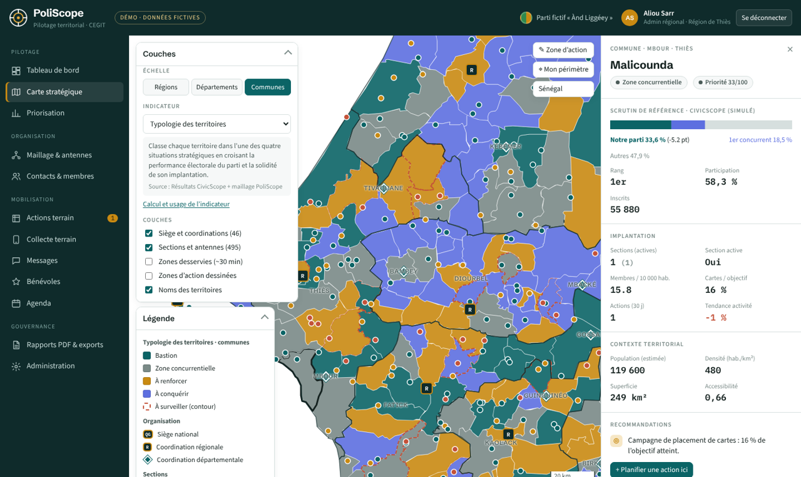
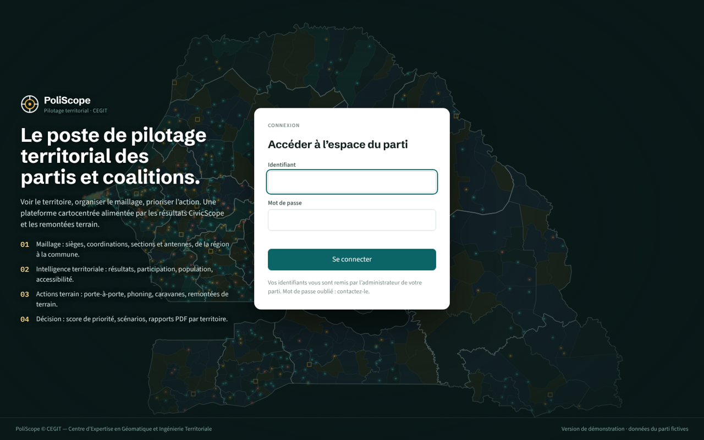
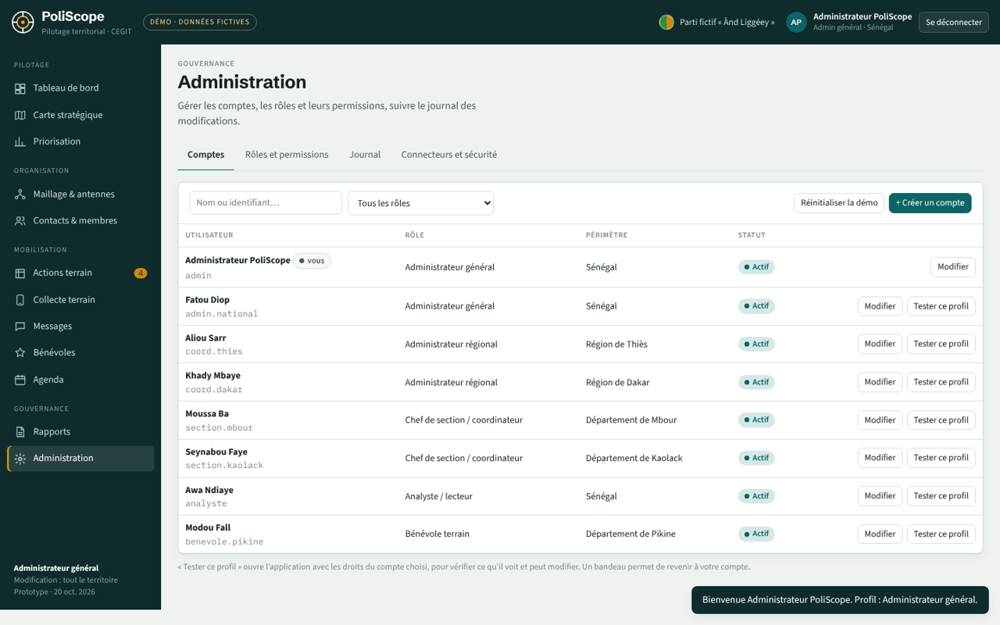
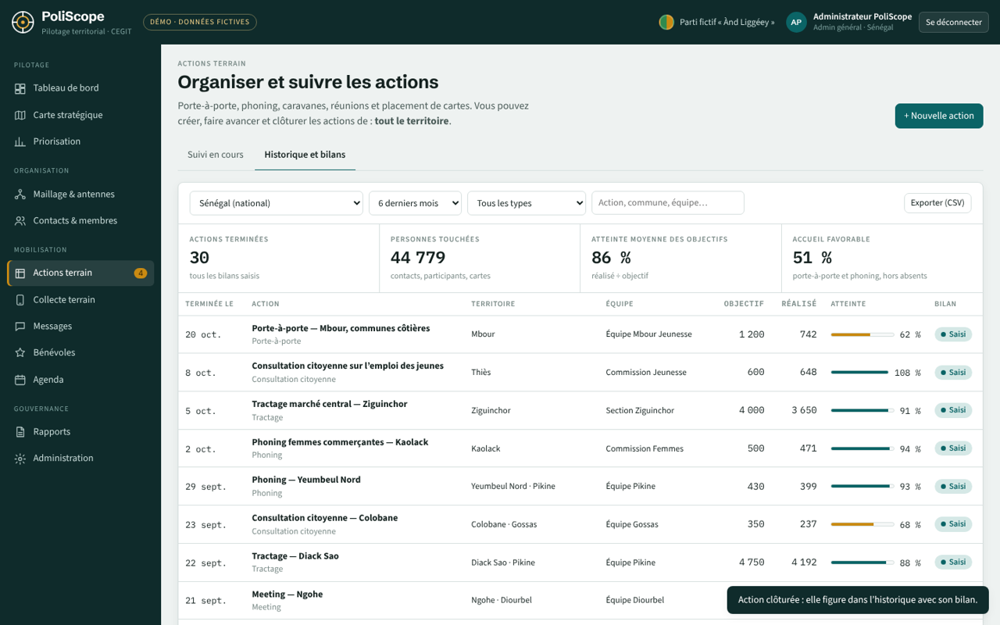
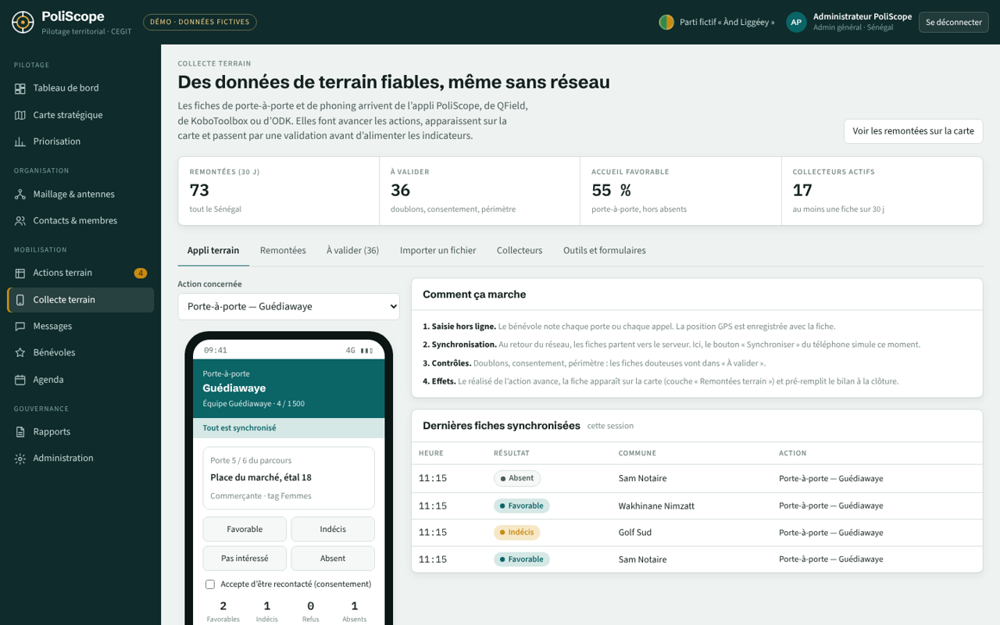
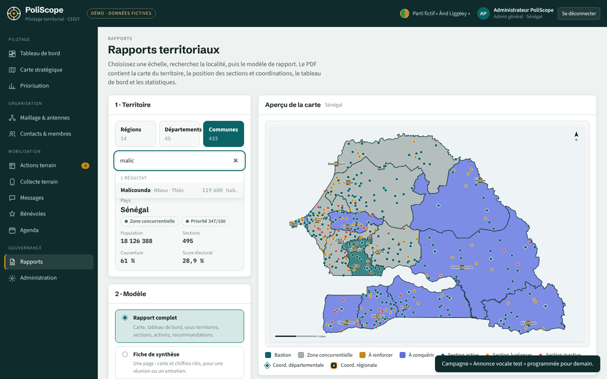
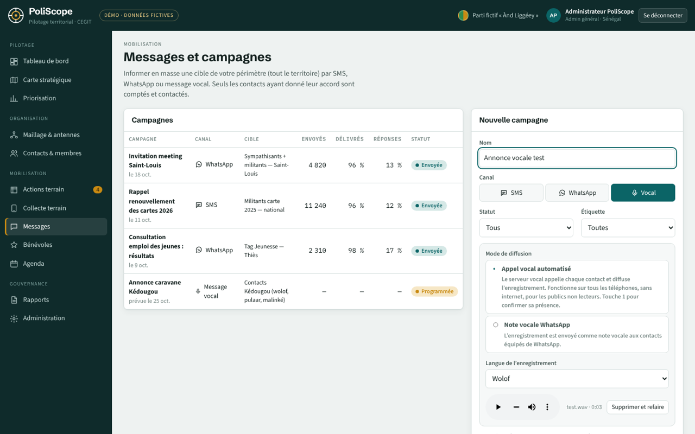

<p align="center"></p>

# PoliScope

**Le poste de pilotage territorial des partis et coalitions.**
PoliScope est une plateforme cartocentrée de stratégie politique conçue par le **CEGIT** (Centre d'Expertise en Géomatique et Ingénierie Territoriale) pour les acteurs politiques du Sénégal et de la sous-région. Elle transforme les données internes d'un parti et les données territoriales en priorités d'action : voir le territoire, organiser le maillage, prioriser l'action.

PoliScope est la solution « partis politiques » de la famille de [CivicScope](docs/integration-civicscope.md), la plateforme électorale du CEGIT. CivicScope cartographie et diffuse les résultats d'un scrutin. PoliScope s'appuie sur ces résultats pour alimenter ses indicateurs.

> **Démo en ligne : https://bathie18.github.io/poliscope/**
> Prototype fonctionnel. Les données du parti (« Ànd Liggéey », parti fictif) sont **simulées**. Les limites administratives et la population RGPH-5 sont réelles (voir [Données géographiques](docs/donnees-geographiques.md)).



---

## Sommaire

- [Accès à la démonstration](#accès-à-la-démonstration)
- [Fonctionnalités](#fonctionnalités)
- [Pile technique 100 % open source](#pile-technique-100--open-source)
- [Structure du dépôt](#structure-du-dépôt)
- [Lancer le prototype en local](#lancer-le-prototype-en-local)
- [Documentation](#documentation)
- [Sources et licences des données](#sources-et-licences-des-données)

## Accès à la démonstration

L'application s'ouvre sur un écran de connexion, avec la carte du Sénégal en fond. Chaque profil voit le Sénégal entier, mais ne modifie que son propre périmètre. Les comptes de test ci-dessous ne sont pas affichés à l'écran : ils sont listés ici.

| Identifiant | Mot de passe | Profil | Périmètre de modification |
|---|---|---|---|
| `admin` | `admin` | Administrateur général | Tout le Sénégal, gestion des comptes |
| `admin.national` | `National2026` | Administrateur général | Tout le Sénégal, gestion des comptes |
| `coord.thies` | `Thies2026` | Administrateur régional | Région de Thiès |
| `coord.dakar` | `Dakar2026` | Administrateur régional | Région de Dakar |
| `section.mbour` | `Mbour2026` | Chef de section / coordinateur (`admin_section`) | Département de Mbour |
| `section.kaolack` | `Kaolack2026` | Chef de section / coordinateur (`admin_section`) | Département de Kaolack |
| `analyste` | `Analyse2026` | Analyste / lecteur | Aucune modification, pas de données nominatives |
| `benevole.pikine` | `Pikine2026` | Bénévole terrain | Actions et collecte du département de Pikine |

Une fois connecté avec `admin`, l'onglet **Administration** permet de créer, modifier, désactiver ou supprimer des comptes, de régler les permissions de chaque rôle, et de **tester n'importe quel profil** (« Tester ce profil »), avec un bandeau pour revenir à son compte.
Ces comptes sont fictifs : dans le prototype, l'authentification est simulée côté navigateur. En production, elle repose sur Keycloak et les droits sont appliqués par l'API et par PostgreSQL (voir [Rôles et permissions](docs/roles-permissions.md)).

## Fonctionnalités

PoliScope suit les cinq piliers du dossier de cadrage.

| Pilier | Ce que fait le prototype |
|---|---|
| **1. Maillage territorial** | Siège, coordinations régionales et départementales, sections et antennes géolocalisées ; fiches modifiables selon le profil ; proposition d'antenne avec validation. |
| **2. CRM organisationnel** | Contacts (militants, sympathisants, bénévoles), étiquettes, cartes, historique, **consentement obligatoire**. Données nominatives limitées au périmètre du profil. |
| **3. Intelligence territoriale** | Carte à **trois échelles** (régions, départements, communes), fond **OpenStreetMap ou blanc**, 8 indicateurs documentés, panneaux **Couches** et **Légende** dans la carte, zones desservies (~30 min). |
| **4. Actions terrain** | Porte-à-porte, phoning, caravanes, réunions ; tableau de suivi ; zone d'action dessinée sur la carte ; **clôture avec fiche bilan** et **historique** filtrable ; **collecte terrain** reliée aux actions (appli, import de fichiers KoboToolbox / QField / ODK, file de validation, statistiques par collecteur, couche « Remontées terrain » sur la carte) ; messages **SMS, WhatsApp et vocaux** (enregistrement au micro ou import d'un fichier audio). |
| **5. Pilotage & décision** | Tableau de bord par territoire, score de priorité à pondération réglable, matrice score × couverture, scénarios d'ouverture d'antennes, **rapports PDF territoriaux** (choix de l'échelle, recherche de la localité, quatre modèles), exports CSV / GeoJSON. |
| **Gouvernance** | Console d'administration : comptes, rôles et permissions modifiables, test des profils, journal des modifications. |

Les indicateurs cartographiques sont décrits en détail dans [docs/indicateurs.md](docs/indicateurs.md) :
typologie des territoires, score de priorité, score électoral, rang du parti, couverture communale, participation, membres pour 10 000 habitants, tendance d'activité sur 90 jours.

| Connexion | Administration |
|---|---|
|  |  |
| **Historique des actions** | **Collecte terrain** |
|  |  |
| **Rapports** | **Message vocal** |
|  |  |

## Pile technique 100 % open source

| Couche | Prototype (ce dépôt) | Cible de production |
|---|---|---|
| Interface | HTML, CSS, JavaScript sans framework | Même base, découpée en modules (Vite) |
| Cartographie | [Leaflet](https://leafletjs.com) 1.9.4 (BSD-2), fonds OpenStreetMap (ODbL) | Leaflet ou MapLibre GL, tuiles vectorielles [Martin](https://martin.maplibre.org), fonds OSM auto-hébergés |
| Rapports | [jsPDF](https://github.com/parallax/jsPDF) + AutoTable (MIT) | WeasyPrint (BSD) côté serveur, archivage |
| Messages vocaux | Enregistrement navigateur (MediaRecorder) | Asterisk (GPL) : appels automatisés via un trunk SIP opérateur |
| Données | GeoJSON statiques | PostgreSQL 16 + PostGIS 3 (limites administratives CEGIT) |
| API | — | FastAPI (MIT), OpenAPI 3 ([api/openapi.yaml](api/openapi.yaml)) |
| Identité et droits | Simulation navigateur | Keycloak (Apache-2.0, OpenID Connect) + PostgreSQL Row-Level Security |
| Collecte terrain | Formulaires fournis | QField / QFieldCloud (GPL), KoboToolbox (AGPL), ODK Central (Apache-2.0) |
| Exploitation | GitHub Pages | Docker Compose, Nginx, MinIO, pgBackRest |
| Polices | Schibsted Grotesk, Source Sans 3, IBM Plex Mono (SIL OFL), auto-hébergées | idem |

Toutes les bibliothèques sont **embarquées dans le dépôt** (`assets/vendor/`, `assets/fonts/`) : la page n'appelle aucun CDN. Seules les tuiles OpenStreetMap sont chargées à la demande, quand ce fond est choisi.

## Structure du dépôt

```
poliscope/
├── index.html                  Point d'entrée de l'application (GitHub Pages)
├── assets/
│   ├── css/                    Feuilles de style (thèmes clair et sombre)
│   ├── js/
│   │   ├── config.js           Rôles, comptes de démo, indicateurs documentés
│   │   ├── data.js             Construction du jeu de données de démonstration
│   │   ├── app.js              Connexion, droits, routage, modules
│   │   ├── map.js              Carte stratégique (Leaflet)
│   │   └── report.js           Rapports PDF et exports
│   ├── data/                   Régions, départements, communes (GeoJSON, WGS84)
│   ├── fonts/  img/  vendor/   Polices, logos et captures, bibliothèques tierces
├── docs/                       Documentation fonctionnelle et technique
├── database/schema.sql         Schéma PostGIS cible, avec Row-Level Security
├── api/openapi.yaml            Contrat d'API REST cible
├── collecte/                   Formulaires XLSForm (Kobo/ODK) et projet QField type
├── deploy/                     Squelette Docker Compose de production
└── tools/build_geodata.py      Script de préparation des couches géographiques
```

## Lancer le prototype en local

Les couches géographiques sont chargées par `fetch()`. Il faut donc passer par un petit serveur web plutôt que d'ouvrir `index.html` en double-cliquant dessus :

```bash
git clone https://github.com/bathie18/poliscope.git
cd poliscope
python3 -m http.server 8000
# puis ouvrir http://localhost:8000
```

Publication : le dépôt est servi tel quel par GitHub Pages depuis la branche `main` (voir [docs/deploiement.md](docs/deploiement.md)).

## Documentation

| Document | Contenu |
|---|---|
| [Architecture](docs/architecture.md) | Architecture cible, composants, flux de données, sécurité |
| [Indicateurs](docs/indicateurs.md) | Définition, calcul, source et usage de chaque indicateur |
| [Rôles et permissions](docs/roles-permissions.md) | Profils, périmètres, matrice des droits, politiques RLS |
| [Modèle de données](docs/modele-donnees.md) | Entités, relations, correspondance avec `database/schema.sql` |
| [Collecte terrain](docs/collecte-terrain.md) | QField, KoboToolbox, ODK : formulaires et synchronisation |
| [Intégration CivicScope](docs/integration-civicscope.md) | Import des résultats aux trois échelles |
| [Données géographiques](docs/donnees-geographiques.md) | Sources, licences, remplacement par les couches PostGIS du CEGIT |
| [Guide utilisateur](docs/guide-utilisateur.md) | Parcours par profil |
| [Protection des données](docs/protection-donnees.md) | Loi n° 2008-12, CDP, consentement, minimisation |
| [Déploiement](docs/deploiement.md) | GitHub Pages (prototype) et Docker Compose (production) |
| [Feuille de route](docs/feuille-de-route.md) | V1 maillage, V2 mobilisation, V3 décision avancée |

## Sources et licences des données

| Donnée | Source | Statut |
|---|---|---|
| Limites des régions, départements, communes | GADM v4.1, via le paquet R `mapSenegal` | **Provisoire.** Usage non commercial selon la licence GADM. Ces limites seront remplacées par les couches PostGIS des limites administratives du CEGIT. |
| Population des régions et départements | RGPH-5 2023, ANSD | Réelle |
| Population des communes | Répartition de la population départementale | Estimation |
| Parti, résultats, sections, membres, contacts, actions | Générateur `assets/js/data.js` | Simulés (fictifs) |
| Fond de plan | © contributeurs OpenStreetMap | ODbL |

Les composants tiers et leurs licences sont listés dans [THIRD_PARTY_NOTICES.md](THIRD_PARTY_NOTICES.md).

---

© CEGIT — Centre d'Expertise en Géomatique et Ingénierie Territoriale · [cegitgroup.com](https://cegitgroup.com)
La licence du code de PoliScope reste à définir par le CEGIT. Tous les composants tiers utilisés sont open source.
