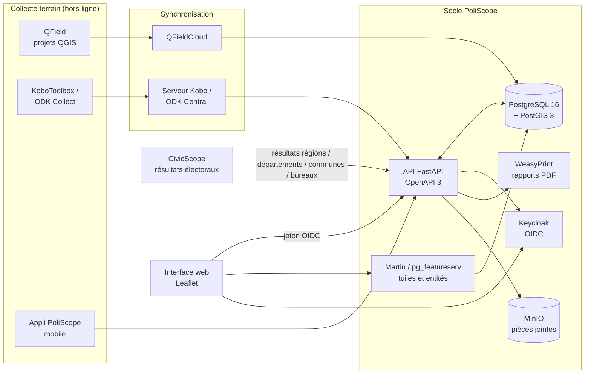
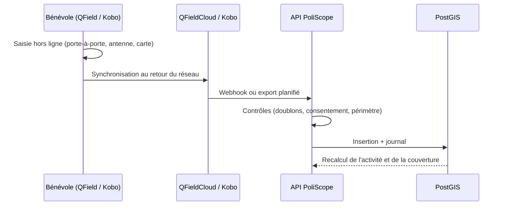
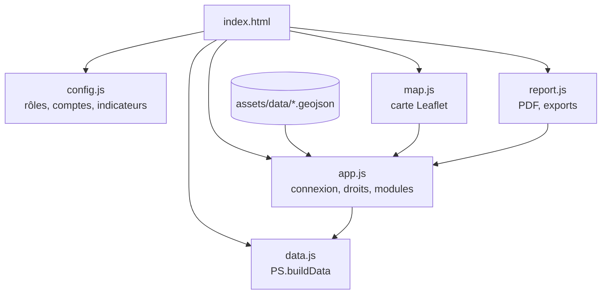

# Architecture

Ce document décrit l'architecture **cible** de PoliScope et la place du prototype publié dans ce dépôt. Toute la pile repose sur des logiciels open source.

## 1. Vue d'ensemble

## 2. Composants

| Composant | Logiciel (licence) | Rôle |
|---|---|---|
| Base de données | PostgreSQL 16 (PostgreSQL), PostGIS 3 (GPL-2) | Limites administratives du CEGIT, maillage, CRM, actions, indicateurs matérialisés, journal |
| API | FastAPI (MIT), SQLAlchemy / GeoAlchemy2 (MIT) | Règles métier, calcul des indicateurs, imports CivicScope et terrain, exports |
| Tuiles et entités | Martin (Apache-2.0 / MIT) ou pg_featureserv (Apache-2.0) | Tuiles vectorielles des communes et des sections, filtrées par rôle |
| Identité | Keycloak (Apache-2.0) | Comptes, rôles, attribut `perimetre`, authentification forte des administrateurs |
| Interface web | Leaflet (BSD-2), JavaScript | Carte, tableaux de bord, modules ; base de ce prototype |
| Collecte | QField / QFieldCloud (GPL-2), KoboToolbox (AGPL-3), ODK Central (Apache-2.0) | Saisie hors ligne, géolocalisation, photos |
| Rapports | WeasyPrint (BSD-3) côté serveur ; jsPDF (MIT) dans le prototype | Rapport territorial PDF |
| Messages vocaux | Asterisk (GPL-2) + trunk SIP d'un opérateur | Appels automatisés diffusant un message enregistré, confirmation par touche |
| Stockage objet | MinIO (AGPL-3) | Photos de permanences, pièces jointes, rapports archivés |
| Exploitation | Docker, Nginx (BSD-2), pgBackRest (MIT), Prometheus / Grafana (Apache-2.0 / AGPL-3) | Déploiement, sauvegardes, supervision |

## 3. Flux principaux

### 3.1 Résultats électoraux (CivicScope)

1. À la clôture d'un scrutin, CivicScope publie les résultats validés, bureau par bureau.
2. L'API PoliScope importe les résultats du parti ou de la coalition suivi : voix, score, rang, inscrits, votants, blancs et nuls.
3. Les agrégats sont recalculés aux trois échelles (commune → département → région) dans des vues matérialisées PostGIS.
4. Les indicateurs « Score électoral », « Rang du parti » et « Participation » sont mis à jour, ainsi que la typologie et le score de priorité.

Détails : [integration-civicscope.md](integration-civicscope.md).

### 3.2 Remontées terrain

### 3.3 Contrôle d'accès

1. L'utilisateur s'authentifie auprès de Keycloak et reçoit un jeton contenant son `role` et son `perimetre` (national, code de région ou code de département).
2. L'API transmet ces valeurs à PostgreSQL (`SET LOCAL poliscope.role`, `poliscope.perimetre`).
3. Les politiques Row-Level Security filtrent les lignes : **lecture** des indicateurs agrégés pour tous, **lecture des données nominatives et écriture** limitées au périmètre.

Voir [roles-permissions.md](roles-permissions.md) et [`database/schema.sql`](../database/schema.sql).

## 4. Le prototype de ce dépôt

Le prototype est une application statique (HTML, CSS, JavaScript) publiée sur GitHub Pages. Il reproduit les écrans et les règles métier de la cible, sans serveur :

| Cible | Prototype |
|---|---|
| Keycloak + RLS | `PS.canEdit()` et `PS.canSeePII()` dans `assets/js/app.js` |
| PostGIS | `assets/data/*.geojson` + générateur `assets/js/data.js` |
| Vues matérialisées d'indicateurs | Agrégation commune → département → région dans `data.js` |
| WeasyPrint | jsPDF dans `assets/js/report.js` |
| Journal d'audit | `PS.log()`, conservé dans le navigateur |

Organisation du code :

## 5. Principes

- **Une donnée saisie une fois** est réutilisée dans les cartes, les actions et les rapports.
- **Chaque territoire ne voit que ce qui lui est autorisé** : la carte et les agrégats sont partagés, les données nominatives et la modification sont cloisonnées.
- **Souveraineté** : hébergement possible au Sénégal, aucune dépendance à un service propriétaire obligatoire. Les canaux SMS et WhatsApp passent par des connecteurs optionnels.
- **Sobriété réseau** : interface légère, tuiles vectorielles, collecte hors ligne.
