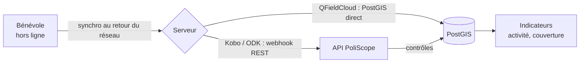

# Collecte terrain : QField, KoboToolbox, ODK

PoliScope n'impose pas son propre outil de collecte. Il s'appuie sur des outils **open source** déjà connus des équipes au Sénégal, tous utilisables **hors connexion**.

| Outil | Licence | Usage dans PoliScope |
|---|---|---|
| **QField** + QFieldCloud | GPL-2.0 | Saisie cartographique sur un projet QGIS : position des sections et permanences, secteurs de porte-à-porte, relevés GPS |
| **KoboToolbox** (KoBoCollect) | AGPL-3.0 | Formulaires XLSForm : porte-à-porte, recensement des antennes, placement de cartes, émargement |
| **ODK Collect** + ODK Central | Apache-2.0 | Même formulaires XLSForm, serveur auto-hébergeable, chiffrement des soumissions |
| Appli PoliScope (PWA) | — | Parcours simplifié pour bénévoles : porte-à-porte et phoning guidés |

## Formulaires fournis

Le dossier [`collecte/`](../collecte/) contient :

| Fichier | Contenu |
|---|---|
| `kobo/poliscope_porte_a_porte.xlsx` | Formulaire XLSForm : adresse, résultat de la visite, sujets évoqués, consentement, position GPS |
| `kobo/poliscope_recensement_antennes.xlsx` | Recensement d'une section ou antenne : niveau, responsable, effectifs, photo, position GPS |
| `qfield/README.md` | Structure du projet QGIS à déployer sur QFieldCloud (couches, formulaires, contraintes) |

Ces formulaires s'importent tels quels dans KoboToolbox (« Importer un XLSForm ») ou dans ODK Central.

## Synchronisation vers PoliScope

1. **QField** travaille directement sur des couches PostGIS via QFieldCloud. Les modifications sont synchronisées dans les tables `maillage.structure` et `terrain.remontee`, et le périmètre est contrôlé par les politiques RLS.
2. **KoboToolbox / ODK** envoient chaque soumission à l'API (`POST /terrain/remontees`, voir [`api/openapi.yaml`](../api/openapi.yaml)) par webhook (« REST Services » dans Kobo).
3. L'API applique trois contrôles :
   - doublons (même adresse et même date) ;
   - consentement (sans case cochée, le contact n'est pas enregistré dans le CRM) ;
   - périmètre (un bénévole ne peut pas saisir hors de son département).
4. Les vues d'indicateurs sont rafraîchies : tendance d'activité, couverture communale, statut des sections.

## Bonnes pratiques terrain

- Préparer un **secteur** sur la carte PoliScope (« Zone d'action ») avant chaque sortie. Il est exporté vers le projet QField de l'équipe.
- Faire **synchroniser** les téléphones chaque soir, ou au QG s'il y a du Wi-Fi.
- Utiliser les **listes de choix en langues locales** (wolof, pulaar, sérère, diola, mandinka) dans les XLSForm pour les messages lus aux personnes rencontrées.
- Ne jamais noter d'opinion politique déclarée, d'appartenance ethnique ou religieuse : le formulaire ne prévoit pas ces champs (voir [protection-donnees.md](protection-donnees.md)).
