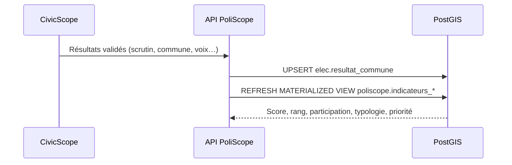

# Intégration avec CivicScope

**CivicScope** est la plateforme électorale cartocentrée du CEGIT. Elle accompagne les administrations électorales, les autorités, les acteurs politiques et les médias sur tout le cycle électoral :
- elle cartographie l'électorat pour préparer le scrutin ;
- elle sécurise la remontée et la validation des résultats bureau par bureau ;
- elle diffuse les résultats aux trois échelles (régions, départements, communes) avec des outils d'analyse.

**PoliScope** réutilise ces résultats. Pour un parti ou une coalition, CivicScope fournit, à chaque échelle et pour chaque scrutin, **ses voix, son score et son rang**. Ce sont ces données qui alimentent les indicateurs électoraux de PoliScope.

## Données importées

| Donnée CivicScope | Utilisation dans PoliScope |
|---|---|
| Inscrits, votants, exprimés, blancs et nuls | Participation, poids électoral (score de priorité) |
| Voix du parti / de la coalition | Score électoral, marge de progression |
| Voix du premier concurrent, classement | Rang du parti, répartition des voix dans les fiches |
| Scrutins précédents | Évolution du score, signal « À surveiller » |
| Bureaux de vote (localisation) | Ciblage fin du porte-à-porte (V3) |

## Mode d'échange

1. **Référentiel commun** : CivicScope et PoliScope utilisent les mêmes codes et limites administratives (couches PostGIS du CEGIT). Les jointures se font sans table de correspondance.
2. **API** : PoliScope interroge l'API de CivicScope après validation des résultats, ou reçoit une notification (webhook). Les résultats sont stockés dans `elec.resultat_commune` (voir [`database/schema.sql`](../database/schema.sql)).
3. **Agrégation** : les résultats communaux sont agrégés au département et à la région dans PoliScope. Les règles sont celles de CivicScope : somme des voix, scores recalculés sur les exprimés.
4. **Scrutin de référence** : l'administrateur général choisit le scrutin affiché par défaut. Les autres scrutins servent aux comparaisons.

## Dans le prototype

Le prototype simule ces résultats pour un parti fictif. Les fiches de territoire indiquent « Scrutin de référence · CivicScope (simulé) ». Le connecteur apparaît dans **Administration → Connecteurs et sources**.
