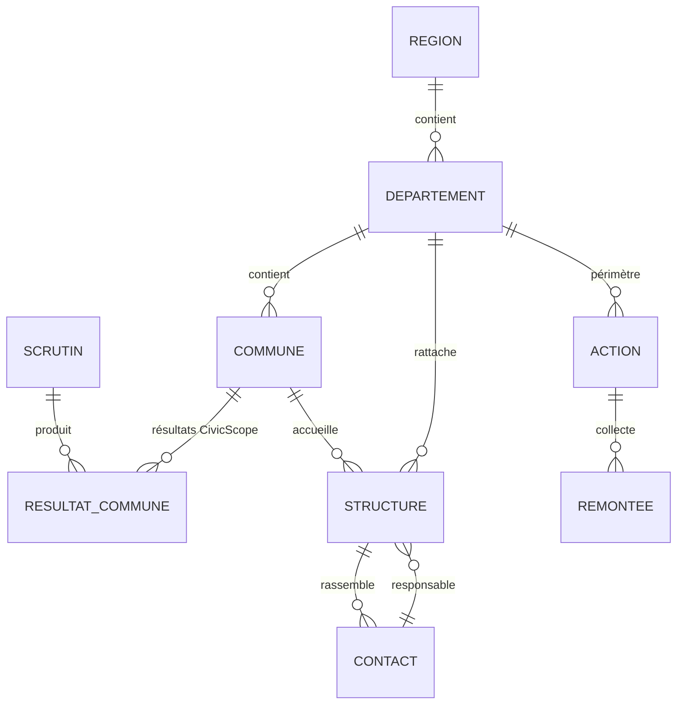

# Modèle de données

Le modèle cible est implanté dans PostgreSQL / PostGIS ([`database/schema.sql`](../database/schema.sql)). Il est organisé en schémas par domaine.

| Schéma | Tables | Rôle |
|---|---|---|
| `ref` | `region`, `departement`, `commune` | Limites administratives du CEGIT, population RGPH-5 |
| `elec` | `scrutin`, `resultat_commune` | Résultats importés de CivicScope (voix, exprimés, rang) |
| `maillage` | `structure` | Siège, coordinations, sections, sous-sections, antennes (point géolocalisé, statut calculé) |
| `crm` | `contact` | Militants, sympathisants, bénévoles ; consentement obligatoire et daté |
| `terrain` | `action`, `remontee` | Actions planifiées (avec zone dessinée), fiches QField / Kobo / ODK / appli |
| `audit` | `journal` | Qui a modifié quoi, quand (triggers) |
| `poliscope` | `dans_perimetre()`, `indicateurs_commune` | Sécurité (RLS) et indicateurs matérialisés |

## Règles de gestion

- **Statut d'une structure** : calculé à partir de la date de dernière activité (≤ 30 jours : active ; 31 à 90 jours : à relancer ; au-delà : inactive).
- **Validation** : une antenne proposée par un chef de section n'est comptée dans les indicateurs qu'après validation par la coordination (`valide = true`).
- **Consentement** : un contact ne peut pas être enregistré sans consentement (`CHECK (consentement)`). L'échéance est fixée à 24 mois.
- **Agrégation** : les indicateurs sont calculés à la commune, puis agrégés au département et à la région. Les effectifs sont additionnés, les taux sont pondérés par les inscrits.

## Correspondance avec le prototype

| Objet du prototype (`assets/js/data.js`) | Table cible |
|---|---|
| `communes[]`, `depts[]`, `regions[]` | `ref.*` + `poliscope.indicateurs_*` |
| `sections[]`, `coordsReg[]`, `coordsDep[]`, `hq` | `maillage.structure` |
| `contacts[]` | `crm.contact` |
| `actions[]` | `terrain.action` |
| `audit[]` | `audit.journal` |
